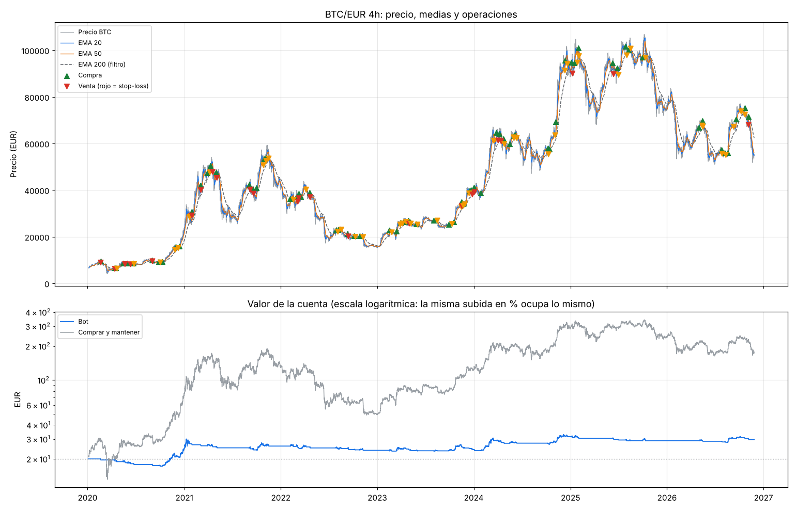

# Bot de trading para aprender

Bot de trading de Bitcoin escrito en Python y pensado para **aprender desde cero**. Cada pieza está explicada en el código y en la carpeta [`docs/`](docs/00-empieza-aqui.md).

- **Qué opera:** BTC/EUR en Binance, solo *spot* (sin apalancamiento).
- **Estrategia:** cruce de medias móviles (EMA 20/50) con filtro de tendencia (EMA 200).
- **Riesgo:** máximo un 2 % por operación, stop-loss del 5 %, frenos de emergencia y tu regla del x2 (al duplicar, aparta lo invertido).
- **Modos:** backtest → simulación con precios reales → testnet de Binance → dinero real (bloqueado por defecto).

> ⚠️ Herramienta educativa. No es asesoramiento financiero. Resultados pasados no garantizan resultados futuros. Puedes perder el dinero que inviertas.

## 👉 Empieza aquí: [docs/00-empieza-aqui.md](docs/00-empieza-aqui.md)

## Arranque rápido

```bash
cd trading-bot
python -m venv .venv
source .venv/bin/activate          # Windows: .venv\Scripts\activate
pip install -r requirements.txt

python -m pytest -q tests          # comprobar que todo funciona
python -m bot backtest             # probar la estrategia con datos desde 2020
python -m bot simular              # bot en directo con dinero ficticio
```

## Resultado del backtest (2020-2026, 20 €)



| | Bot | Comprar BTC y no tocarlo |
|---|---|---|
| Capital final | 29,72 € (+48,6 %) | 176,79 € (+783,9 %) |
| Peor caída | 22 % | 74 % |
| Operaciones | 74 (26 % de acierto) | 1 |

El bot gana **mucho menos** que comprar y mantener, pero con caídas **mucho menores**. En [docs/05-backtesting.md](docs/05-backtesting.md) se explica por qué, y por qué no hay que fiarse de los parámetros "óptimos".

## Documentación

| | |
|---|---|
| [00 · Empieza aquí](docs/00-empieza-aqui.md) | Plan de aprendizaje, instalación y comandos |
| [01 · Conceptos básicos](docs/01-conceptos-basicos.md) | Trading, BTC, exchange, velas, comisiones, drawdown |
| [02 · Cómo funciona el bot](docs/02-como-funciona-el-bot.md) | Cada archivo del código y cómo se conectan |
| [03 · La estrategia](docs/03-estrategia.md) | Medias móviles, reglas de compra y venta, cuándo falla |
| [04 · Gestión del riesgo](docs/04-gestion-del-riesgo.md) | Tamaño de posición, stop-loss, frenos, regla x2 |
| [05 · Backtesting](docs/05-backtesting.md) | Cómo leer los resultados, sobreajuste y ejercicios |
| [06 · Paper trading](docs/06-paper-trading.md) | Modo simular y testnet de Binance paso a paso |
| [07 · Dinero real](docs/07-dinero-real.md) | Checklist, claves seguras e impuestos en España |
| [08 · Avisos por Telegram](docs/08-avisos-telegram.md) | Mensajes al móvil en cada operación |
| [09 · Glosario](docs/09-glosario.md) | Todas las palabras técnicas |
| [10 · Siguientes pasos](docs/10-siguientes-pasos.md) | 24/7, mejoras, futuros e inversión a largo plazo |

## Comandos

| Comando | Qué hace |
|---|---|
| `python -m bot backtest [--robustez] [--desde AAAA-MM-DD] [--hasta AAAA-MM-DD]` | Backtest con informe, gráfico y semáforo de fiabilidad |
| `python -m bot simular` | En directo, dinero ficticio, sin cuenta |
| `python -m bot testnet` | En directo en el testnet de Binance |
| `python -m bot real` | Dinero real (requiere `CONFIRMO_DINERO_REAL=si` en `.env`) |
| `python -m bot estado <modo>` | Saldo, posición y últimas operaciones |
| `python -m bot reiniciar <modo>` | Empezar de cero (simular / testnet) |
